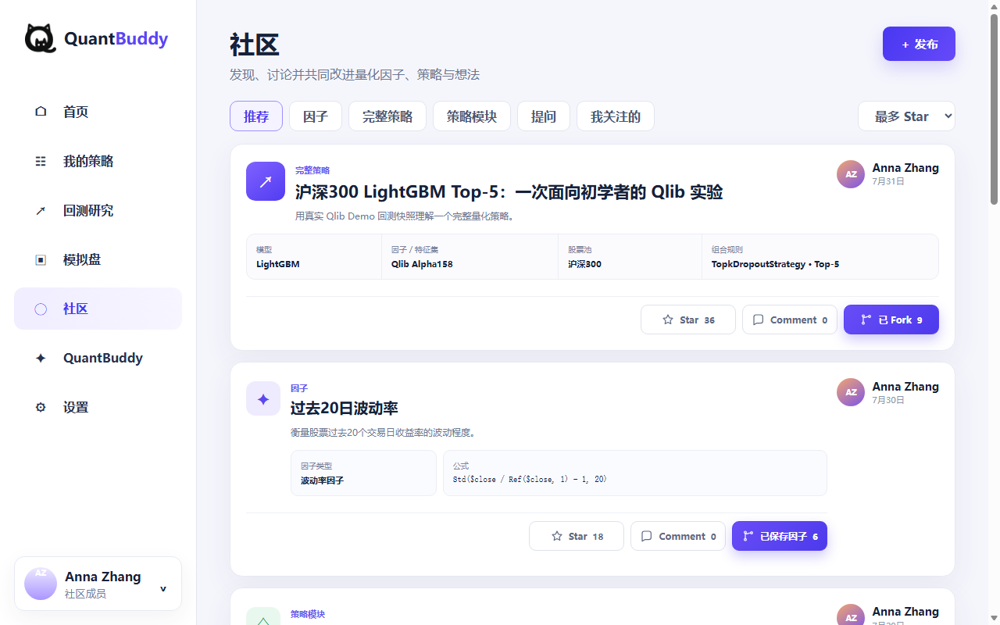

# QuantBuddy

QuantBuddy is a beginner-oriented quantitative research workspace. The repository combines a Next.js product frontend, a safety-restricted Python service layer, offline Qlib/data-preparation utilities, and a standalone bilingual Community prototype.

> Project status: active prototype. Research, backtesting, Community, and read-only simulated-account views are available at different maturity levels. AI assistance and live trading are not implemented.



## Highlights

- Beginner-friendly quantitative strategy and factor workspace.
- Backtest research views backed by curated Qlib demo data.
- Community feed, publishing, comments, stars, and local strategy/factor forks.
- Chinese/English standalone prototype with a persistent language selector.
- Read-only Futu service boundary with explicit protections against real trading.

## Repository structure

```text
QuantBuddy/
├─ frontend/                         Next.js 16 + React 19 application
├─ backend/                          FastAPI and safety-restricted Futu services
├─ scripts/                          Data, Qlib, signal, and audit utilities
├─ configs/                          Quantitative workflow configuration
├─ docs/
│  ├─ reports/                       Engineering and verification reports
│  ├─ prototypes/                    Historical UI/design sources
│  └─ screenshots/community/         Community QA captures
├─ QuantBuddy_Community_Final.html   Standalone bilingual prototype
└─ .gitignore                        Local data, secrets, builds, and outputs
```

Local datasets and generated research artifacts remain in ignored directories such as `data/`, `artifacts/`, `outputs/`, and `mlruns/`. They are intentionally excluded from the public source tree.

## Prerequisites

- Node.js 20 or newer
- pnpm
- Python 3.11 or newer

## Quick start

### Standalone bilingual prototype

Open [`QuantBuddy_Community_Final.html`](QuantBuddy_Community_Final.html) directly in a modern browser. Use the selector in the upper-right corner to switch between Chinese and English. The prototype stores demo state and the language preference in browser-local storage; it is not a multi-user backend.

You can also serve the repository locally:

```powershell
python -m http.server 8080
```

Then open `http://localhost:8080/QuantBuddy_Community_Final.html`.

### Product frontend

```powershell
cd frontend
pnpm install
pnpm dev
```

Open `http://localhost:3000`.

### Read-only local backend

From the repository root:

```powershell
python -m venv .venv-futu
.\.venv-futu\Scripts\Activate.ps1
python -m pip install -r backend\requirements.txt
python -m uvicorn backend.api.main:app --host 127.0.0.1 --port 8000
```

The exposed Futu API is read-only. Real trading is rejected, and simulated-order writes remain disabled unless a separate operator-controlled workflow explicitly enables them.

## Verification

Frontend:

```powershell
cd frontend
pnpm test
pnpm build
```

Backend isolated tests:

```powershell
python -m unittest discover -s backend\tests -p "test_*.py" -v
```

Do not run broker-connected smoke tests unless you understand their local prerequisites and safety boundaries.

## Documentation

See [`docs/README.md`](docs/README.md) for the documentation map, prototype history, and engineering reports. Publication checks are tracked in [`docs/PUBLICATION_CHECKLIST.md`](docs/PUBLICATION_CHECKLIST.md).

## Security and data handling

- Never commit `.env` files, account identifiers, credentials, private market data, or broker logs.
- Local Futu configuration is restricted to China A-share simulated accounts.
- Generated datasets and experiment outputs are excluded by `.gitignore`.
- The standalone prototype uses illustrative/demo content and browser-local persistence.

## License

No open-source license has been selected yet. Choose and add a `LICENSE` file before offering public reuse rights.
