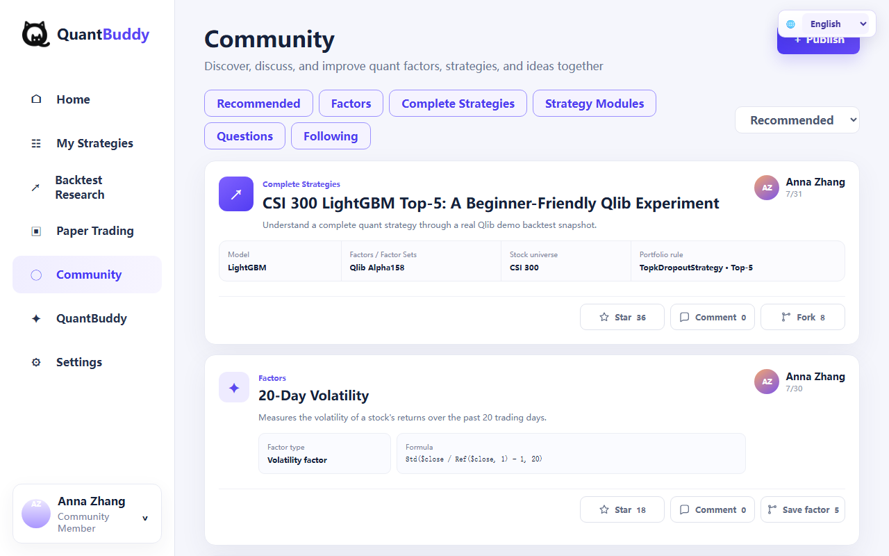
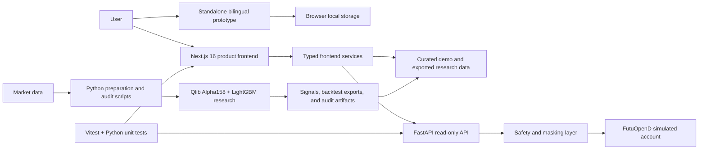

# QuantBuddy

QuantBuddy is a bilingual quantitative research workspace for learning, building, evaluating, and sharing systematic investment strategies. It combines a production-oriented Next.js application, a safety-restricted Python service layer, offline Qlib research pipelines, and a self-contained browser prototype.

> **Project status:** active prototype and research platform. Research, backtesting, strategy/factor management, Community workflows, and read-only simulated-account views are implemented at different maturity levels. AI assistance, multi-user cloud persistence, and automated trading are roadmap items—not current production capabilities.

[Open the live bilingual prototype](https://080617.github.io/QuantBuddy/) · [Browse the source](https://github.com/080617/QuantBuddy)



## Product scope

| Area | Current capability | Primary implementation |
| --- | --- | --- |
| Onboarding | Knowledge level, capital, risk tolerance, horizon, and model selection | Standalone prototype |
| Strategy workspace | Complete strategies, reusable modules, factors, and factor sets | Next.js + browser-local services |
| Backtest research | Performance summary, benchmark comparison, signals, and audit views | Next.js + exported Qlib demo data |
| Community | Browse, filter, publish, star, comment, follow, and fork reusable research assets | Next.js and standalone prototype |
| Paper trading | Read-only simulated-account portfolio and order views | Next.js + FastAPI + Futu service boundary |
| Research pipeline | CSI 300 data preparation, Qlib normalization, Alpha158/LightGBM baseline, signals, and audits | Python scripts + YAML configuration |

## System architecture



### Architectural boundaries

- **`QuantBuddy.html`** is the portable bilingual prototype and the source served by GitHub Pages. It is intentionally self-contained and uses browser-local persistence.
- **`frontend/`** is the formal product UI. Page components consume typed service adapters instead of directly coupling views to storage or backend implementations.
- **`backend/`** exposes a small FastAPI read-only surface around safety-restricted Futu services. Account and order identifiers are masked before reaching the browser.
- **`scripts/` and `configs/`** form the offline research/data pipeline. Large local datasets and generated experiment outputs are excluded from Git.
- **`docs/`** preserves design provenance, implementation reports, verification evidence, and current English screenshots.

## Methods

### Quantitative research workflow

1. Download and repair CSI 300 market data.
2. Normalize the dataset into Qlib-compatible storage.
3. Prepare the benchmark and validate Alpha158 features.
4. Run the configured LightGBM baseline and Top-5 portfolio workflow.
5. Export backtest metrics, navigation curves, signals, and audit artifacts.
6. Adapt curated outputs into frontend-safe data contracts.

The included baseline is an educational and reproducible reference, not an investment recommendation. Historical results do not imply future performance.

### Product engineering approach

- **Typed boundaries:** TypeScript types and service adapters separate UI components from storage and API concerns.
- **Progressive integration:** browser-local prototype behavior is validated first, then promoted into the formal Next.js application.
- **Safety by default:** real trading is rejected, simulated writes are disabled by default, and the web API exposes read-only endpoints only.
- **Traceable research:** configuration, signal validation, execution planning, and audit reports are kept as explicit artifacts.
- **Verification:** the repository currently passes 20 frontend tests, a production Next.js build across 24 routes, and 143 Python tests.

## Repository layout

```text
QuantBuddy/
├─ QuantBuddy.html             Standalone bilingual prototype
├─ index.html                  GitHub Pages entry point
├─ frontend/                   Next.js 16 + React 19 product application
├─ backend/                    FastAPI and safety-restricted Futu services
├─ scripts/                    Data, Qlib, signal, and audit utilities
├─ configs/                    Quantitative workflow configuration
├─ docs/
│  ├─ prototypes/              Historical UI/design sources
│  ├─ reports/                 Engineering and verification reports
│  └─ screenshots/prototype/   Current English-mode product captures
└─ .gitignore                  Local data, secrets, builds, and outputs
```

Local datasets and generated research artifacts remain in ignored directories such as `data/`, `artifacts/`, `outputs/`, and `mlruns/`.

## Quick start

### Standalone bilingual prototype

Open [`QuantBuddy.html`](QuantBuddy.html) directly in a modern browser, or visit the [live GitHub Pages deployment](https://080617.github.io/QuantBuddy/). The language selector in the upper-right corner switches between Chinese and English and remembers the browser-local preference.

To serve it locally:

```powershell
python -m http.server 8080
```

Then open `http://localhost:8080/QuantBuddy.html`.

### Product frontend

Prerequisites: Node.js 20 or newer and pnpm.

```powershell
cd frontend
pnpm install
pnpm dev
```

Open `http://localhost:3000`.

### Read-only local backend

Prerequisite: Python 3.11 or newer.

```powershell
python -m venv .venv-futu
.\.venv-futu\Scripts\Activate.ps1
python -m pip install -r backend\requirements.txt
python -m uvicorn backend.api.main:app --host 127.0.0.1 --port 8000
```

Do not run broker-connected smoke tests unless you understand their local prerequisites and safety boundaries.

## Verification

```powershell
cd frontend
pnpm test
pnpm build
```

```powershell
python -m unittest discover -s backend\tests -p "test_*.py" -v
```

## Development roadmap

### Near term

- Consolidate validated standalone-prototype flows into the formal Next.js application.
- Replace the runtime translation layer with structured application-wide internationalization.
- Connect backtest views to reproducible job metadata and versioned research artifacts.
- Add browser-level end-to-end tests for onboarding, workspace, Community, and language switching.
- Improve accessibility, responsive behavior, and mobile navigation.

### Medium term

- Add authenticated user profiles and durable strategy/factor storage.
- Add queued backtest execution, experiment tracking, and side-by-side model comparison.
- Build an AI research copilot for factor explanation, strategy diagnostics, and guided onboarding.
- Add Community moderation, asset versioning, attribution, and reproducible forks.
- Introduce continuous integration and automated preview deployments.

### Longer term

- Add operator-controlled simulated execution with explicit approvals and complete audit trails.
- Build scheduled market-data refresh and research pipelines.
- Add observability, data-quality monitoring, and model-drift diagnostics.
- Evaluate additional markets, universes, models, and portfolio construction methods.

Real-money automated trading is explicitly outside the current scope and would require separate security, legal, operational, and risk reviews.

## Documentation

See [`docs/README.md`](docs/README.md) for the documentation map and [`docs/PUBLICATION_CHECKLIST.md`](docs/PUBLICATION_CHECKLIST.md) for release checks.

## Security and data handling

- Never commit `.env` files, credentials, account identifiers, private market data, or broker logs.
- Local Futu integration is restricted to China A-share simulated accounts.
- Generated datasets, environments, caches, and experiment outputs are excluded by `.gitignore`.
- The standalone prototype uses illustrative/demo content and browser-local persistence.

## License

No open-source license has been selected yet. Source is publicly visible, but public reuse rights have not been granted.
