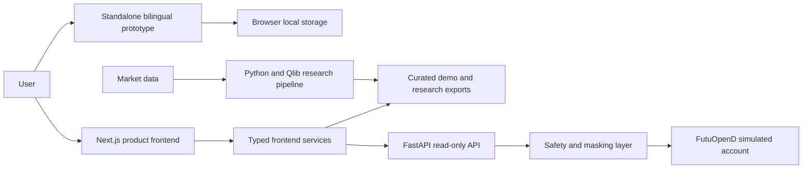

# QuantBuddy Documentation

> **Start here:** [`../README.md`](../README.md) is the main project README. It contains the complete product overview, architecture, setup instructions, verification results, and development roadmap.

[Open the live bilingual prototype](https://080617.github.io/QuantBuddy/) · [View the main project README](../README.md) · [Browse the repository](https://github.com/080617/QuantBuddy)

## Project at a glance

QuantBuddy is a bilingual quantitative research workspace for learning, building, evaluating, and sharing systematic investment strategies. The repository currently contains four connected layers:

| Layer | Purpose | Main location |
| --- | --- | --- |
| Standalone prototype | Portable Chinese/English product demonstration with browser-local state | [`../QuantBuddy.html`](../QuantBuddy.html) |
| Product frontend | Formal Next.js application for onboarding, research, strategies, Community, and paper-account views | [`../frontend/`](../frontend/) |
| Service backend | Read-only FastAPI boundary for safety-restricted simulated-account data | [`../backend/`](../backend/) |
| Research pipeline | CSI 300 data preparation, Qlib Alpha158/LightGBM research, signals, exports, and audits | [`../scripts/`](../scripts/) and [`../configs/`](../configs/) |

## Architecture overview

- The standalone prototype is self-contained and is the version published through GitHub Pages.
- The Next.js frontend uses typed service adapters so UI components are not coupled directly to storage or backend implementations.
- The FastAPI backend is read-only and masks sensitive account and order identifiers before data reaches the browser.
- Research scripts generate reproducible signals, backtest results, and audit artifacts that can be adapted into frontend-safe contracts.

## Methods

### Quantitative research workflow

1. Download and repair CSI 300 market data.
2. Normalize the dataset into Qlib-compatible storage.
3. Prepare the benchmark and validate Alpha158 features.
4. Run the configured LightGBM baseline and Top-5 portfolio workflow.
5. Export metrics, navigation curves, signals, and audit artifacts.
6. Adapt curated outputs into typed frontend data contracts.

### Product engineering approach

- **Typed boundaries:** TypeScript contracts and service adapters separate presentation from data access.
- **Progressive integration:** workflows are validated in the portable prototype before being promoted into the formal application.
- **Safety by default:** real trading is rejected, simulated writes are disabled by default, and the public API surface is read-only.
- **Traceable research:** configuration, signal validation, execution planning, and audit reports remain explicit artifacts.
- **Verification:** the current repository passes 20 frontend tests, a 24-route production build, and 143 Python tests.

## Development roadmap

### Near term

- Consolidate validated prototype workflows into the formal Next.js application.
- Replace runtime text translation with structured application-wide internationalization.
- Connect backtests to reproducible job metadata and versioned research artifacts.
- Add browser-level tests for onboarding, workspace, Community, and language switching.

### Medium term

- Add authentication and durable strategy/factor storage.
- Add queued backtests, experiment tracking, and side-by-side model comparison.
- Build an AI research copilot for explanation, diagnostics, and guided onboarding.
- Add Community moderation, asset versioning, attribution, and reproducible forks.

### Longer term

- Add operator-controlled simulated execution with explicit approvals and audit trails.
- Schedule market-data refresh and research pipelines.
- Add data-quality monitoring, observability, and model-drift diagnostics.
- Evaluate additional markets, models, universes, and portfolio construction methods.

Real-money automated trading is outside the current scope and would require separate security, legal, operational, and risk reviews.

## Current documentation map

- [`../README.md`](../README.md) — canonical project overview, full architecture, setup, verification, and roadmap.
- [`reports/`](reports/) — implementation, integration, safety, and verification reports.
- [`prototypes/`](prototypes/) — historical standalone UI sources retained for design provenance.
- [`screenshots/prototype/`](screenshots/prototype/) — current English-mode product and interaction captures.
- [`PUBLICATION_CHECKLIST.md`](PUBLICATION_CHECKLIST.md) — public repository and release checks.
- [`../backend/README.md`](../backend/README.md) — backend safety boundaries and local API instructions.
- [`../frontend/README.md`](../frontend/README.md) — frontend setup and application routes.

## Current prototype

The current standalone product demonstration is [`QuantBuddy.html`](../QuantBuddy.html). Its upper-right language selector switches between Chinese and English and remembers the browser-local preference.
